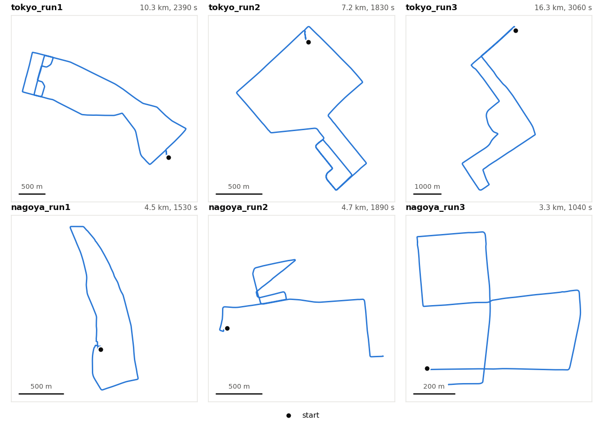
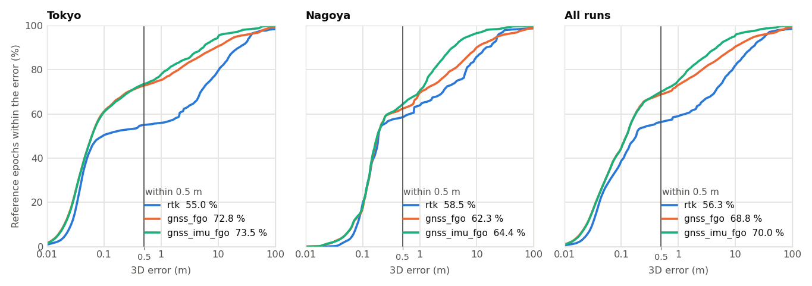
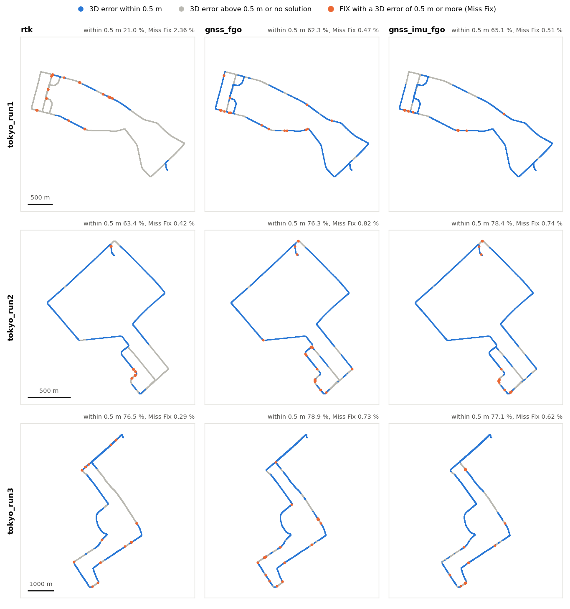
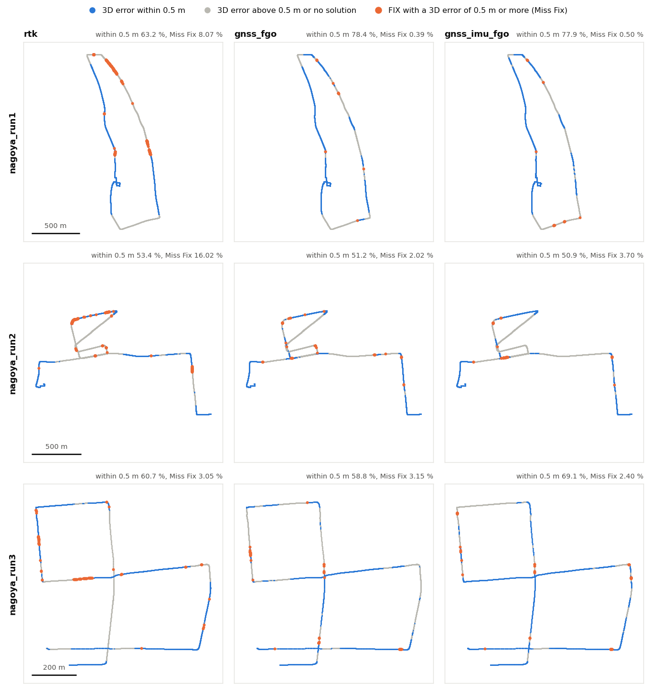

# PPC-Dataset-ROS2

Unofficial ROS 2 conversion of the [PPC-Dataset](https://github.com/taroz/PPC-Dataset)
by Taro Suzuki. Please cite the original dataset when using these recordings.

The bags use the message definitions of
[gnss_ros_standardization](https://github.com/DaikiNiimi/gnss_ros_standardization).
Build the release of that package that matches this dataset; the message
definitions must be identical for the bags to deserialize.

## Contents and time convention

| Topic | ROS type | Nominal rate | Source |
|---|---|---|---|
| `/gnss/observation` | `gnss_ros_standardization/msg/GnssObservations` | 5 Hz | `rover.obs` |
| `/base/gnss/observation` | `gnss_ros_standardization/msg/GnssObservations` | 1 Hz | `base.obs` |
| `/gnss/ephemeris` | `gnss_ros_standardization/msg/GnssEphemerides` | at transmission time | `base.nav` |
| `/gnss/imu/data_raw` | `sensor_msgs/msg/Imu` | 100 Hz | `imu.csv` |
| `/gnss/reference/solution` | `gnss_ros_standardization/msg/GnssSolution` | 5 Hz | `reference.csv` |
| `/gnss/reference/solution_odom` | `nav_msgs/msg/Odometry` | 5 Hz | `reference.csv` |

Header stamps and bag timestamps use **GPST, not UTC**. GNSS week/TOW is also
GPST. Each bag includes `gnss_time_basis.yaml`; do not interpret the timestamps
as UTC without a time-scale conversion. Source gaps are kept; missing epochs are
not interpolated.

IMU acceleration is in m/s², angular velocity in rad/s (converted from deg/s),
in the source axes (`imu_link`), without lever-arm correction. The reference
solution keeps the source LLH/ECEF position and ENU velocity; its `pos_enu` is
relative to the first reference position, recorded in `pos_enu_org_ecef`.
Values the source does not provide (`age_diff`, DOP and covariances) are NaN. The
reference Odometry uses the same origin as the ENU `map` frame; attitude is in
`map` (from roll, pitch and heading clockwise from North), linear twist in
`base_link`.

## Runs

| Run | First observation (GPST) | Duration | Messages | MCAP bytes |
|---|---|---|---|---|
| `nagoya_run1` | 2024-08-03 08:53:00 | 1530 s | 177,457 | 27,266,898 |
| `nagoya_run2` | 2024-07-20 10:22:00 | 1890 s | 219,263 | 33,834,240 |
| `nagoya_run3` | 2024-08-03 09:50:00 | 1040 s | 120,656 | 18,247,638 |
| `tokyo_run1` | 2024-07-23 04:04:30 | 2390 s | 277,244 | 39,065,495 |
| `tokyo_run2` | 2024-07-23 01:10:00 | 1830 s | 212,447 | 35,394,262 |
| `tokyo_run3` | 2024-07-23 01:51:00 | 3060 s | 355,244 | 59,684,988 |



`bags/<run>/` contains one MCAP file (lossless Zstandard chunk compression), the
metadata and the time-basis sidecar. Each MCAP file is below 100 MB.

## Navigation messages

Each navigation record is published at its transmission time (RINEX `ttr`;
GLONASS `tof`), as a receiver stream delivers it in real time. Records
transmitted before the first observation epoch are published together **1 s
before the first observation**, so that playback delivers them before the first
epoch. Records transmitted after the last observation epoch are omitted.

Each message also carries the ionosphere parameters of the `base.nav` header
(GPS, Galileo, QZSS, BeiDou). The topics carry legacy Kepler GPS/Galileo/QZSS/BeiDou
ephemerides and GLONASS ephemerides: **8,256 records** across the six runs. The source files contain
20,712 records (a file shared by several runs is counted once for each run). Not
published are the 5,698 SBAS records, which the message types cannot represent;
records without an orbit, which receivers publish as "unhealthy, no orbit"; and
records transmitted after the last epoch.

## What was checked

- Observations: all 12 RINEX observation files were parsed independently of
  RTKLIB's `obs_t` selection. **70,380 epochs and 8,345,592 signal
  observations** matched the topics: satellite/signal identity, week/TOW,
  P/L/D/CN0, missing components, LLI bits and GLONASS frequency channels.
  BeiDou C51–C63 are kept. P and L use absolute tolerance 1e-6; float32 D/CN0
  use `max(1e-6, abs(source) * 6e-8)`. Identifiers, flags and counts match
  exactly.
- A zero measurement value in these bags comes from a zero (missing) field in the
  source RINEX files; treat it as missing.
- Navigation: every published record matched the fields of its source record.
- IMU and reference: every CSV row matched its message (header time within 1 µs).
- Playback: each compressed bag was played into a new recorder; all topic
  counts and ordered payload hashes matched.

## Replay

```bash
source /opt/ros/jazzy/setup.bash
source /path/to/gnss_ros_standardization/install/setup.bash
ros2 bag info bags/nagoya_run1
ros2 bag play bags/nagoya_run1 --rate 1
```

Use reliable subscriptions; the navigation topic uses transient-local
durability. Start subscribers before playback if every message must be received.
The player offers the recorded history depth: 2000 for the observation and
reference topics, 20000 for the IMU and 256 for the navigation topic.

## Baseline results

`results/<run>_<method>.pos` are the solutions of `real_time_kinematic` (`rtk`),
`gnss_fgo` and `gnss_imu_fgo` of gnss_ros_standardization v1.1.0, in RTKLIB
format. Each bag was played once at `--rate 1`.

| Item | Value |
|---|---|
| Parameters | `config/ppc/<city>_rtk.yaml`, `<city>_gnss_fgo.yaml`, `<city>_gnss_imu_fgo.yaml` |
| Constellations | GPS, Galileo, BeiDou, QZSS |
| Frequencies | L1, L2 |
| Elevation mask | 15 deg |
| SNR mask | 35 dB-Hz, rover and base |
| Ambiguity resolution | fix and hold, ratio threshold 3.0 |
| `gnss_imu_fgo` | NHC and ZUPT enabled; IMU-to-antenna lever arm (FLU, m) Tokyo `[0.31, 0.0, 0.55]`, Nagoya `[1.422, -0.171, 1.216]` |

The Nagoya lever arm is not the value of the PPC-Dataset README,
`(0.593, -0.670, -1.216)` in FRD; it refers to the antenna recorded in `rover.obs`.

| Metric | Definition |
|---|---|
| Fix rate | FIX epochs / reference epochs |
| Miss Fix rate | FIX epochs with a 3D error of 0.5 m or more / FIX epochs |
| 3D <= 0.5 m | epochs with a 3D error of 0.5 m or less, any solution status / reference epochs |
| 3D RMS | over the epochs that have a solution |

The error is the distance between the solution and the reference position of the
same epoch (time tags within 2 ms). Totals use summed epoch counts.

| Run | Method | Fix rate % | Miss Fix rate % | 3D <= 0.5 m % | 3D RMS m |
|---|---|---|---|---|---|
| `tokyo_run1` | `rtk` | 19.84 | 2.36 | 20.99 | 31.75 |
| `tokyo_run1` | `gnss_fgo` | 46.07 | 0.47 | 62.27 | 24.80 |
| `tokyo_run1` | `gnss_imu_fgo` | 46.24 | 0.51 | 65.12 | 12.35 |
| `tokyo_run2` | `rtk` | 59.91 | 0.42 | 63.45 | 9.87 |
| `tokyo_run2` | `gnss_fgo` | 46.79 | 0.82 | 76.29 | 16.10 |
| `tokyo_run2` | `gnss_imu_fgo` | 47.26 | 0.74 | 78.41 | 3.72 |
| `tokyo_run3` | `rtk` | 71.81 | 0.29 | 76.50 | 5.97 |
| `tokyo_run3` | `gnss_fgo` | 46.34 | 0.73 | 78.90 | 24.95 |
| `tokyo_run3` | `gnss_imu_fgo` | 43.19 | 0.62 | 77.13 | 7.80 |
| `nagoya_run1` | `rtk` | 67.25 | 8.07 | 63.19 | 15.42 |
| `nagoya_run1` | `gnss_fgo` | 46.96 | 0.39 | 78.43 | 39.33 |
| `nagoya_run1` | `gnss_imu_fgo` | 44.84 | 0.50 | 77.87 | 2.22 |
| `nagoya_run2` | `rtk` | 63.01 | 16.02 | 53.43 | 10.63 |
| `nagoya_run2` | `gnss_fgo` | 24.65 | 2.02 | 51.23 | 12.72 |
| `nagoya_run2` | `gnss_imu_fgo` | 26.89 | 3.70 | 50.85 | 9.39 |
| `nagoya_run3` | `rtk` | 56.10 | 3.05 | 60.70 | 4.84 |
| `nagoya_run3` | `gnss_fgo` | 37.86 | 3.15 | 58.83 | 21.19 |
| `nagoya_run3` | `gnss_imu_fgo` | 42.49 | 2.40 | 69.10 | 2.73 |
| Tokyo | `rtk` | 51.76 | 0.59 | 55.00 | 19.28 |
| Tokyo | `gnss_fgo` | 46.36 | 0.67 | 72.78 | 22.99 |
| Tokyo | `gnss_imu_fgo` | 45.22 | 0.61 | 73.51 | 8.89 |
| Nagoya | `rtk` | 62.85 | 10.40 | 58.48 | 11.58 |
| Nagoya | `gnss_fgo` | 35.39 | 1.56 | 62.34 | 26.49 |
| Nagoya | `gnss_imu_fgo` | 36.69 | 2.00 | 64.38 | 6.39 |
| All | `rtk` | 55.97 | 4.77 | 56.32 | 16.77 |
| All | `gnss_fgo` | 42.19 | 0.95 | 68.81 | 24.38 |
| All | `gnss_imu_fgo` | 41.98 | 1.08 | 70.04 | 8.04 |



Share of the reference epochs within a 3D error. The legend gives the value at 0.5 m.





Every reference epoch is drawn at its reference position.

The table and the figures (Matplotlib) are the output of:

```bash
python3 tools/evaluate.py
python3 tools/plot_results.py
```

To score another solution, record it, convert it and name it
`results/<run>_<method>.pos`:

```bash
ros2 run gnss_ros_standardization gnss_fgo --ros-args \
  --params-file /path/to/gnss_ros_standardization/config/ppc/tokyo_gnss_fgo.yaml &
ros2 bag record -s mcap -o /path/to/solution-bag --topics /gnss/solution &
ros2 bag play bags/tokyo_run1 --rate 1
ros2 run gnss_ros_standardization rosbag_to_pos \
  --bag /path/to/solution-bag --out results/tokyo_run1_gnss_fgo.pos
python3 tools/evaluate.py --methods gnss_fgo
```

## Reproduce

Each run was converted with the software's `rinex_to_rosbag` (default
`--eph-mode transmission`):

```bash
ros2 run gnss_ros_standardization rinex_to_rosbag \
  --obs rover=/path/to/run/rover.obs --obs base=/path/to/run/base.obs \
  --nav /path/to/run/base.nav \
  --topic-obs rover=/gnss/observation --topic-obs base=/base/gnss/observation \
  --timestamp-scale gpst --storage mcap --out /path/to/new-bag \
  --imu /path/to/run/imu.csv --imu-frame raw --reference /path/to/run/reference.csv
```

It was then compressed with `ros2 bag convert` and this configuration:

```yaml
output_bags:
  - uri: /path/to/compressed-bag
    storage_id: mcap
    storage_preset_profile: zstd_small
    all_topics: true
```

```bash
ros2 bag convert -i /path/to/new-bag mcap -o compression.yaml
cp /path/to/new-bag/gnss_time_basis.yaml /path/to/compressed-bag/
```

Compressed bytes can vary with library versions. To compare a regenerated bag,
compare the decoded payloads and timestamps, not the file hash. To produce
sqlite3 instead, use `storage_id: sqlite3` and omit `storage_preset_profile`.

## License

MIT. See [LICENSE](LICENSE). Derived from PPC-Dataset, Copyright (c) 2025 Taro
Suzuki. No upstream endorsement is implied.
